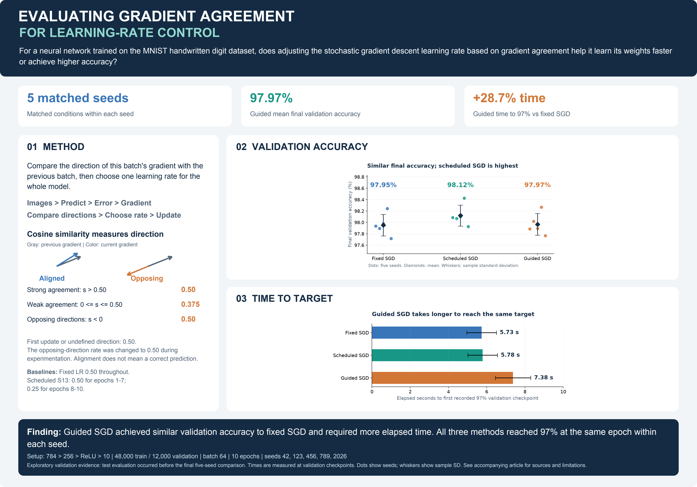

# Evaluating Gradient Agreement for Learning-Rate Control

An experimental study of whether agreement between consecutive mini-batch gradients can improve the speed or accuracy of neural-network training. The project implements a gradient-guided learning-rate controller in PyTorch and compares it with fixed and scheduled stochastic gradient descent (SGD) using five matched random seeds.

[Research report (PDF)](Gradient_Agreement_Report.pdf) · [Research poster (PDF)](Gradient_Agreement_Poster.pdf) · [Poster image (PNG)](Gradient_Agreement_Poster.png)

## Research question

> For a neural network trained on the MNIST handwritten digit dataset, does adjusting the stochastic gradient descent learning rate based on gradient agreement help it learn its weights faster or achieve higher accuracy?

## Key findings

The tested controller achieved nearly the same mean final validation accuracy as fixed SGD, but required more elapsed time. Scheduled SGD produced the highest observed mean final validation accuracy.

| Method | Final validation accuracy (%) | Time to first recorded ≥97% (s) | Total elapsed time (s) |
|---|---:|---:|---:|
| Fixed SGD, LR 0.50 | 97.95 (0.19) | 5.73 (0.77) | 17.84 (0.56) |
| Scheduled SGD, S13 | 98.12 (0.18) | 5.78 (0.77) | 18.10 (0.71) |
| Gradient-guided SGD | 97.97 (0.19) | 7.38 (0.92) | 22.78 (0.67) |

Values are means across five seeds, with sample standard deviations in parentheses. Accuracy variation is expressed in percentage points. Elapsed time includes the training loop and end-of-epoch validation.

- Guided SGD required **28.7% more elapsed time** than fixed SGD to reach the first recorded 97% validation checkpoint.
- All three methods reached the target at the **same epoch within each seed**: epoch 4 for seed 123 and epoch 3 for the remaining seeds.
- The guided-minus-fixed difference in mean final validation accuracy was **0.013 percentage points**, calculated from unrounded results.

Under these conditions, the controller did not demonstrate a practical advantage over the SGD baselines. The results are descriptive comparisons of the tested configurations.

## Research poster

[](Gradient_Agreement_Poster.pdf)

## Method

For each mini-batch, the network produces class scores, cross-entropy loss is calculated, and backpropagation produces gradients. The guided method then compares the current gradient vector with the previous gradient vector using cosine similarity and selects one learning rate for the entire model.

```text
Image batch → Predictions → Loss → Gradients
                                      ↓
                         Compare with previous gradient
                                      ↓
                          Select rate → SGD update
```

Cosine similarity measures agreement in direction. It does not indicate whether the model's prediction is correct. The vectors include gradients for all trainable weights and biases, and the previous gradient is retained across batches and epoch boundaries.

| Condition | Learning rate |
|---|---:|
| Strong agreement: similarity > 0.50 | 0.50 |
| Weak nonnegative agreement: 0 ≤ similarity ≤ 0.50 | 0.375 |
| Opposing directions: similarity < 0 | 0.50 |
| First update or undefined similarity | 0.50 |

The opposing-direction rate was intentionally changed to 0.50 during experimentation, assigning the same rate to strong and opposing directions. Across the five main guided runs, the reduced rate was selected for 14,667 of 37,500 updates (39.1%). Negative agreement accounted for 22,828 updates; the five initial updates used the fallback rate. No strong-agreement update was recorded.

The baselines used the following rules:

- **Fixed SGD:** learning rate 0.50 throughout training.
- **Scheduled SGD (S13):** learning rate 0.50 for epochs 1–7, followed by 0.25 for epochs 8–10.

## Experimental setup

| Component | Configuration |
|---|---|
| Dataset | MNIST handwritten digits; 28 × 28 grayscale images |
| Main data split | 48,000 training images and 12,000 validation images |
| Preprocessing | Tensor conversion to values in [0, 1]; flatten to 784 inputs |
| Architecture | 784 inputs → 256 hidden units → ReLU → 10 class scores |
| Trainable parameters | 203,530 weights and biases |
| Loss and optimizer | Cross-entropy; SGD without momentum |
| Training budget | Batch size 64; 10 epochs; 7,500 updates per run |
| Random seeds | 42, 123, 456, 789, 2026 |
| Within-seed controls | Matched split, initial weights, batch order, architecture, and training budget |
| Validation frequency | Once at the end of each epoch |

The target metric is the first recorded validation checkpoint at or above 97%. Its timing reflects the epoch checkpoint, rather than the exact instant the threshold was crossed.

### Evaluation sequence and scope

The separate 10,000-image test set was evaluated **before** the final five-seed comparison. That earlier evaluation used seed 42, fixed SGD at learning rate 0.60, scheduled SGD S13, and guided SGD with threshold 0.60. The fixed rate and guided threshold differ from the main comparison above. Those test results are reported separately in the research report; the primary findings here are validation results.

Several learning rates, schedules, and controller thresholds were explored during development. The main findings cover the specified configurations, one dataset, one architecture, one batch size, five seeds, and a 10-epoch budget.

## Implementation

- **Controlled training pipelines:** fixed-rate sweeps, scheduled-rate experiments, and configurable gradient-guided SGD.
- **Gradient instrumentation:** per-update cosine similarity, gradient norms, selected learning rates, and controller categories.
- **Experiment tracking:** epoch-level loss, validation accuracy, elapsed time, completed updates, configuration files, and model checkpoints.
- **Research reporting:** comparisons across matched seeds, sample standard deviations, visualizations, and traceable metric sources.

The main comparison contains 15 training runs. Its reported statistics were recalculated from the saved epoch metrics, and the controller counts were checked against all 37,500 guided step records. Source hashes, the original local metric-file inventory, and the list of published evidence files are available in the [evidence manifest](evidence.json). The repository includes the metrics and configurations supporting the main comparison and the earlier test results; downloaded images, trained checkpoints, and intermediate documents are excluded.

## Reproducing the experiments

The recorded local environment uses Python 3.14.2; the main experiment configurations record PyTorch 2.14.1. Package versions are listed in [requirements.txt](requirements.txt).

For new runs, use a separate working copy containing `script/`, `requirements.txt`, and optionally the downloaded `data/`, with a new experiment `output/` directory. The fixed and scheduled scripts can overwrite existing results; the guided script stops if its experiment results already exist.

From that working copy's root, create an environment and install the recorded dependencies:

```bash
python3 -m venv .venv
source .venv/bin/activate
python -m pip install -r requirements.txt
```

The three configurable training scripts use constants near the top of each file. Set `RANDOM_SEED` to the same value in all three scripts, retain `HIDDEN_NEURONS = 256`, `BATCH_SIZE = 64`, and `EPOCHS = 10`, and run:

```bash
python script/run_fixed_lr_experiments.py
python script/run_scheduled_lr_experiments.py
python script/run_gradient_guided.py
```

Repeat for seeds `42`, `123`, `456`, `789`, and `2026`. The scripts currently specify seed `2026`; one invocation does not run all five seeds. The fixed script runs its configured learning-rate sweep, the scheduled script runs schedules S11–S16, and the guided script runs its configured controller. For the main comparison, select fixed LR 0.50, schedule S13, and the guided rule shown above.

Results are saved by architecture, seed, and configuration under `output/`. The fixed-rate script creates the shared initialization used by the subsequent methods. These instructions describe the existing workflow; a fresh installation and training run were not repeated during report preparation.

`evaluate_test_models.py` retains the earlier seed-42 checkpoint selection described above. It requires model files that are generated by training and are not included in the repository. To reproduce that evaluation, train fixed LR 0.60 and schedule S13 with seed 42, then run guided training with seed 42 and `STRONG_THRESHOLD = 0.60`. The saved test-results CSV is included for reference.

## Repository guide

| Path | Purpose |
|---|---|
| [`script/run_fixed_lr_experiments.py`](script/run_fixed_lr_experiments.py) | Configurable fixed-rate SGD experiments |
| [`script/run_scheduled_lr_experiments.py`](script/run_scheduled_lr_experiments.py) | Configurable scheduled SGD experiments |
| [`script/run_gradient_guided.py`](script/run_gradient_guided.py) | Gradient-guided controller, training, and step logging |
| [`script/analyze_gradients.py`](script/analyze_gradients.py) | Gradient-direction analysis for the earlier 128-unit model |
| [`script/evaluate_test_models.py`](script/evaluate_test_models.py) | Earlier seed-42 test-set evaluation |
| [`output/`](output/) | Selected metrics and configurations supporting the reported results |
| [`Gradient_Agreement_Report.pdf`](Gradient_Agreement_Report.pdf) | Final research article |
| [`Gradient_Agreement_Poster.pdf`](Gradient_Agreement_Poster.pdf) | One-page research poster |
| [`Gradient_Agreement_Poster.png`](Gradient_Agreement_Poster.png) | Poster preview |
| [`evidence.json`](evidence.json) | Source hashes, original experiment inventory, and published evidence list |

The final report and saved experiment configurations document the controller evaluated in the five-seed comparison.

## References

Chang, D., & Yuan, G. (2025). MGUP: A momentum-gradient alignment update policy for stochastic optimization. *Advances in Neural Information Processing Systems, 38*. [Paper](https://proceedings.neurips.cc/paper_files/paper/2025/file/1d769a56c0fd47b03cfa491bdc3be9ba-Paper-Conference.pdf).

MGUP provided the conceptual inspiration. It ranks individual parameters using momentum-gradient alignment and applies different update scales. This project implements a separate experiment using consecutive mini-batch gradient vectors and one global SGD learning rate.

LeCun, Y., Bottou, L., Bengio, Y., & Haffner, P. (1998). Gradient-based learning applied to document recognition. *Proceedings of the IEEE, 86*(11), 2278–2324. [Publication](https://bottou.org/papers/lecun-98h).
